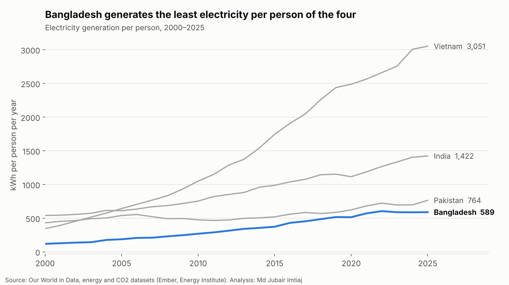
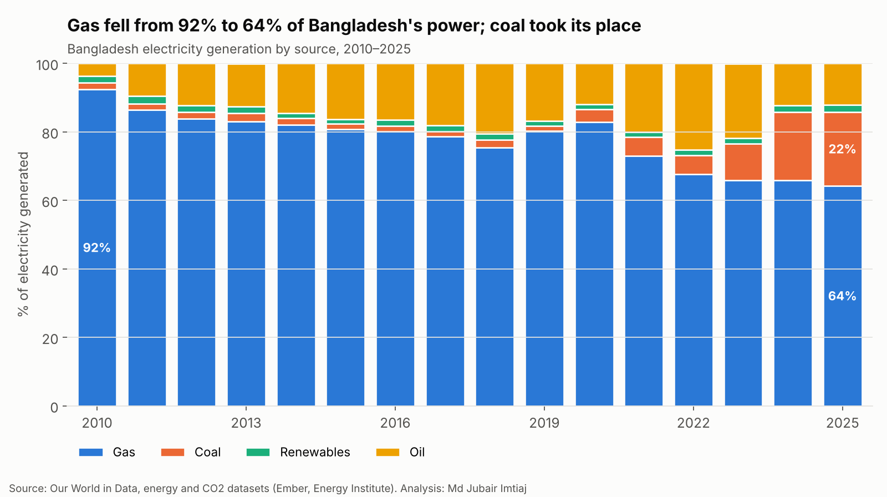
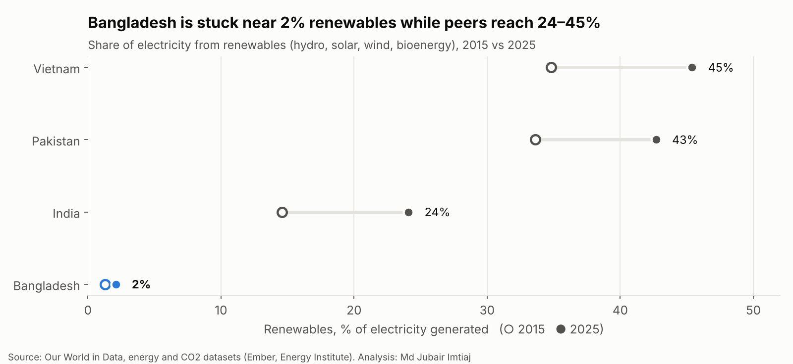
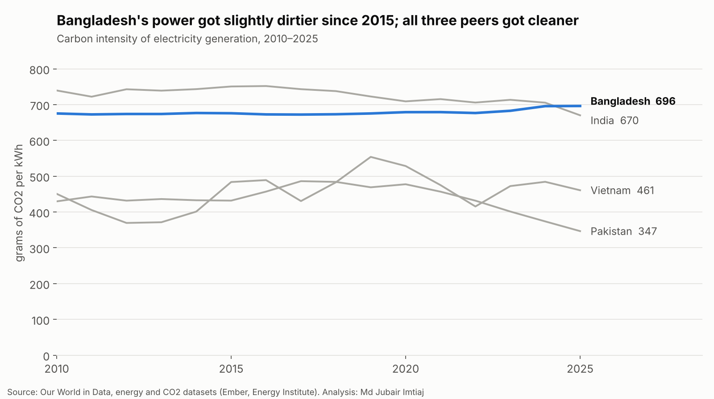

# Bangladesh's electricity: fast growth, gas dependence and a renewables gap

An analysis of how Bangladesh's power sector changed from 2000 to 2025, compared with three peers: India, Pakistan and Vietnam. Built with **SQL (DuckDB)** and **Python (pandas, Matplotlib)** on open data from Our World in Data.

**Bottom line:** Bangladesh grew its electricity 6.5× in 25 years but still generates the least per person of the four. Generation has been flat since 2022, the power mix has swapped gas for coal and imports, and renewables are stuck near 2% while every peer is above 24%.

## Questions

1. How much has generation grown, and how does use per person compare with peers?
2. Has growth slowed recently?
3. How has the power mix changed, and what replaced gas?
4. How do renewables and the carbon intensity of electricity compare with peers?

## Findings

### 1. Six-fold growth, but still the lowest per person



Generation rose from **15.9 TWh in 2000 to 103.4 TWh in 2025**, a 6.5× increase. Even so, each person in Bangladesh gets about **589 kWh a year**, against 764 in Pakistan, 1,422 in India and 3,051 in Vietnam. Bangladesh has caught up a little from 118 kWh in 2000, but Vietnam, which started at 344 kWh, grew its generation 11.7× and pulled far ahead.

### 2. Growth stopped in 2022

From 2016 to 2022 generation grew by about **8% a year** on average. Since then it has barely moved: **102.3 TWh in 2022 and 103.4 TWh in 2025**, with a 1.5% fall in 2023. Per-person generation has slipped from 604 to 589 kWh. (Full year-by-year table: [`results/q2_bd_yoy.csv`](results/q2_bd_yoy.csv).)

### 3. Gas is giving way to coal and imports



Gas supplied **92% of electricity in 2010 but 64% in 2025**. Most of the gap was filled by **coal, which jumped from 4% in 2020 to 22% in 2025**, as new coal-fired plants came online. Imports from India also grew, from nothing before 2014 to **12% of demand in 2025**. Oil peaked at 25% in 2022, when oil-fired plants covered more of the gas shortfall, then fell back to 12%.

### 4. The renewables gap is wide and widening



| Country | Renewables 2015 | Renewables 2025 | Solar 2025 |
|---|---|---|---|
| Bangladesh | 1.3% | **2.1%** | 1.5% |
| India | 14.6% | 24.1% | 9.4% |
| Pakistan | 33.6% | 42.7% | 18.8% |
| Vietnam | 34.8% | 45.4% | 7.4% |

Pakistan shows what is possible: its solar share went from 0.3% to **18.8% in ten years**. Bangladesh's went from 0.3% to 1.5%.

### 5. Cleaner elsewhere, slightly dirtier here



Between 2015 and 2025, each kWh in Bangladesh became slightly more carbon-intensive (**676 → 696 g CO2/kWh**) as coal grew. India (751 → 670), Pakistan (432 → 347) and Vietnam (484 → 461) all got cleaner. Bangladesh's total emissions stay very low per person, **0.66 tonnes of CO2 in 2025**, against 3.69 in Vietnam, so the issue is the direction, not the level.

## What this suggests

- **Supply, not just demand, is the constraint.** Flat generation since 2022 while the population and economy kept growing suggests fuel supply and import costs, rather than lower need, are holding output back.
- **Diversification so far means more coal and imports.** Both reduce gas dependence but add fuel-import exposure and emissions.
- **Solar is the clearest gap.** Neighbouring and similar-income economies, Pakistan above all, have scaled it quickly.

## Limitations

- Figures are Our World in Data compilations of Ember and Energy Institute data; **2025 values are preliminary** and may be revised.
- Shares are of electricity generated in each country, so imported electricity is not part of the power mix (it is reported separately as a share of demand).
- Country comparisons do not adjust for income, climate or geography.

## How it is built

```
sql/01_load.sql        loads the two CSVs into DuckDB tables for the 4 countries, 2000–2025
sql/02_questions.sql   one named query per question (FILTER aggregates, window functions, subqueries)
analysis.py            runs the SQL, saves each result to results/*.csv, draws charts/*.png
results/               query outputs (the table view behind every chart)
charts/                the four charts above
```

Run it:

```bash
pip install -r requirements.txt
./get_data.sh          # downloads the two Our World in Data CSVs into data/
python analysis.py
```

## Data

- Our World in Data, [Energy dataset](https://github.com/owid/energy-data) and [CO2 and greenhouse gas emissions dataset](https://github.com/owid/co2-data), CC BY 4.0.

---

**Md Jubair Imtiaj** · CSE (Information Systems), AIUB · [LinkedIn](https://www.linkedin.com/in/jubair-imtiaj-70b910451) · [GitHub](https://github.com/jubair360)
